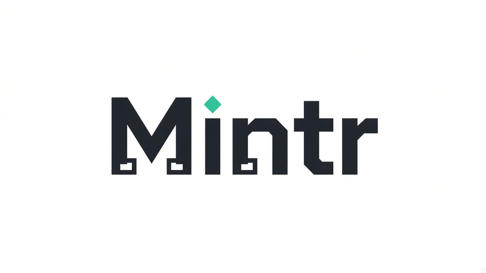

<div align="center">
  <picture>
    <source media="(prefers-color-scheme: dark)" srcset="apps/web/public/assets/mintr/mintr-wordmark-on-dark.png">
    
  </picture>
  <p>Local Windows CAD. Your files stay on this computer.</p>
  <p>
    <a href="LICENSE"></a>
    
    
  </p>
  <p>
    <a href="https://github.com/PeakHorology/peakcad/releases/download/v1.1.2/PeakCAD-Setup-1.1.2.exe"><strong>Download Mintr 1.1.2</strong></a>
  </p>
  <p>Close Mintr, then run <code>PeakCAD-Setup-1.1.2.exe</code>. Setup upgrades in place and keeps your projects.</p>
</div>

Installer, shortcuts, and the Windows apps entry are named **Mintr3d**. The program file is `Mintr.exe`. New projects save as `.mintr`. Older `.peakcad` files still open.

## 1.1.2

- Push Pull: drag a flat face on a CAD-ready shape
- Face outlines and the drag preview match the real shape, including moved Groups
- Projects home, Drop, sketch, and Group hole/solid fixes

[Portable build](https://github.com/PeakHorology/peakcad/releases/download/v1.1.2/PeakCAD-1.1.2-portable.exe) — separate copy, does not install updates.

[All releases](https://github.com/PeakHorology/peakcad/releases)

## Build from source

```bash
npm install
npm run package:desktop
```

That writes `dist-release/PeakCAD-Setup-1.1.2.exe`. `npm run dev` previews `http://127.0.0.1:3000` on this machine only.

## License

[GPL-3.0-or-later](LICENSE) · © PeakHorologyLLC
